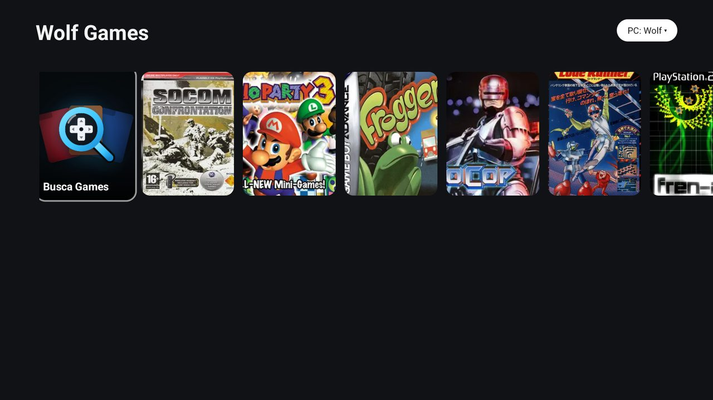

# Wolf Games

**English** · [Português](README.pt-BR.md)

  

Wolf Games is an add-on for the [CleanYourTV](https://github.com/Gathin23/cleanyourtv) launcher that shows the games shared from a PC through Moonlight as a row of covers on Android TV / Google TV. It is for players who stream PC games to the TV and want to launch, resume, close, or switch games without leaving the couch. Each cover renders as a 3D game box whose spines, backs, and disc labels are generated from the single cover image.



*The game shelf: one row of covers, OK launches the selected game.*

## Contents

- [Features](#features)
- [Quick start](#quick-start)
- [Usage](#usage)
- [Configuration](#configuration)
- [Shown only with Moonlight](#shown-only-with-moonlight)
- [Provisioning](#provisioning)
- [Security](#security)
- [Permissions](#permissions)
- [Tested on](#tested-on)
- [Limitations and responsible use](#limitations-and-responsible-use)
- [How it works](#how-it-works)
- [Credits](#credits)
- [License](#license)

## Features

- Launch games from the couch: OK on a cover starts the game through Moonlight.
- Manage sessions without leaving the TV: with the optional Wolf session controller, resume a running game, close it, or close it and open another one.
- See what is running at a glance: the running game's cover gets a soft outline and a play badge.
- Appear where you expect: a module card ("Wolf Games", caption "Stream from your PC") in the CleanYourTV launcher, listed in its SHOWCASE, plus a standalone tile in any Android TV / Google TV launcher.
- Fail visibly, never silently: without Moonlight installed, the screen shows a clear message instead of crashing.
- Close only with confirmation: every stop is confirmed and revision-checked, and nothing is ever stopped implicitly.

## Quick start

Requirements:

- An Android TV / Google TV device (see [Tested on](#tested-on)).
- [Moonlight](https://moonlight-stream.org) installed on the TV. The [Wolf](https://github.com/games-on-whales/wolf) server on the PC is optional.
- `adb` reachable on the TV network for the install and the first catalog push.
- To build from source: JDK 17 and Android SDK 34.

Install the APK from the release and push the first catalog:

```bash
adb connect <tv ip>
adb install -r wolf-games-0.2.0.apk
```

Get `wolf-games-0.2.0.apk` from the [latest release](https://github.com/vitorcamillo/wolf-games/releases/latest). The APK is signed with the Android debug key, for sideload only; check its SHA-256 against the release notes.

Open the add-on once so it creates its `moonlight` folder (a folder made by adb is not readable by the app). Then push a minimal `catalog.json` and reopen the add-on:

```bash
adb push catalog.json /sdcard/Android/data/io.github.vitorcamillo.wolfgames/files/moonlight/catalog.json
```

```json
{
  "schema_version": 1,
  "host_name": "My PC",
  "host_uuid": "12345678-1234-1234-1234-123456789abc",
  "games": [
    {
      "name": "My Game",
      "app_id": "123",
      "image": "123.png"
    }
  ]
}
```

Push each cover next to the catalog (`123.png` in the example) and repeat the push after every change. Press Home and answer Show when the launcher asks about the "Wolf Games" card.

Build from source from the repository root, from a tag or commit you have read:

```bash
./gradlew --no-daemon testReleaseUnitTest lintRelease assembleRelease
adb connect <tv ip>
adb install -r app/build/outputs/apk/release/app-release.apk
```

## Usage

OK on a game launches it through Moonlight (`com.limelight/.ShortcutTrampoline`, extras `Name`/`UUID`/`AppName`, plus `AppId` when the launch went through the session menu). Moonlight V+ (`com.limelight.qiin`) works the same way and is preferred when both are installed.

With a provisioned Wolf session controller, OK first asks the Wolf what is running, then offers to resume the game, close it, or close it and open another one. Every close is confirmed and revision-checked.

## Configuration

The catalog lives in the add-on's own external files directory: `moonlight/catalog.json` plus `*.png`/`*.jpg` covers. It is a JSON object with the following fields:

| Field | Required | Description |
|---|---|---|
| `schema_version` | Yes | Must be `1`. Any other value rejects the catalog. |
| `host_name` | Yes | Display name of the PC (for example in the host picker). |
| `host_uuid` | Yes | UUID of the Moonlight host the catalog belongs to. |
| `games` | Yes | List of games; each has a required `name` and optional `app_id` and `image` (cover file name). |
| `hosts` | No | Optional list of extra hosts, each with `name` and `uuid`. |

You push the catalog with adb, or the add-on refreshes it from the Wolf when the session controller is provisioned (see [Provisioning](#provisioning)).

The optional Wolf session controller is configured with `wolf-control.json` (version 1) in the add-on's external directory:

| Field | Required | Description |
|---|---|---|
| `version` | Yes | Must be `1`. |
| `host_uuid` | Yes | UUID of the Wolf host, checked on every response. |
| `token` | Yes | Bearer credential sent to the controller on every request. |
| `server_certificate` | Yes | Server certificate as base64 DER; it is pinned and checked on every connection. |
| `url` | No | Optional `https://<private IPv4>:47991` fallback, used only when discovery finds nothing. |

There is no address to set: the PC announces the controller on the LAN by mDNS (`_wolf-control._tcp`, port 47991, for example an Avahi service file) and the add-on finds it on whatever IP the PC has, so the same file keeps working when the IP changes or on another PC with the same certificate and token.

## Shown only with Moonlight

Without Moonlight the add-on hides itself: the launcher tile and the module card disappear. Once Moonlight is installed, they come back at the next boot (or when the add-on is updated); to bring them back right away:

```bash
adb shell pm enable io.github.vitorcamillo.wolfgames/.GamesActivity
```

## Provisioning

Open the add-on once first, so it creates its `moonlight` folder (a folder made by adb is not readable by the app). Then push the catalog and covers; repeat after every change and reopen the add-on:

```bash
adb connect <tv ip>
adb push catalog.json /sdcard/Android/data/io.github.vitorcamillo.wolfgames/files/moonlight/catalog.json
adb push 123.png /sdcard/Android/data/io.github.vitorcamillo.wolfgames/files/moonlight/123.png
```

To provision the optional Wolf session controller, push `wolf-control.json` to the add-on's external directory:

```bash
adb push wolf-control.json /sdcard/Android/data/io.github.vitorcamillo.wolfgames/files/wolf-control.json
```

On the first open after the push the add-on validates the file, copies it into its private storage and **deletes the external copy**, so the bearer token does not stay readable on shared storage. An invalid file is discarded, not copied. Until you push a new one, the controller stays as it is; to revoke it, uninstall the add-on (its private storage goes with it).

With the controller provisioned, the add-on also refreshes the catalog and covers from the Wolf itself (same host, same port, same pinned certificate), so a push is only needed when the controller is not provisioned.

## Security

The manifest asks for `INTERNET` and `RECEIVE_BOOT_COMPLETED`, and nothing else. The Wolf bearer token never stays in shared storage: after provisioning, the add-on copies `wolf-control.json` into its private storage and deletes the external copy. If you find a security problem, please report it in the repository's issues.

## Permissions

- `INTERNET` — used only by the optional Wolf session controller: mDNS discovery of `_wolf-control._tcp` on the LAN, then HTTPS to private IPv4 addresses only (10/8, 172.16/12 or 192.168/16), port 47991 only, with a pinned certificate (the address is not checked against it, the certificate and the `host_uuid` in every answer are) and a bearer token, plus the catalog/cover refresh through the same connection. No other host is ever contacted. There is no telemetry, no ads, no analytics, no background service, no polling: the screen reads data when it opens or resumes, and nothing runs behind it.
- `RECEIVE_BOOT_COMPLETED` (start at boot) — a receiver that, on boot, only checks whether Moonlight is installed and shows or hides the tile and the card; it never opens the network and never keeps running.

The launcher itself needs no permission from this add-on: it talks to the launcher only through the module card.

## Tested on

TCL Smart TV Pro, Google TV 14.

## Limitations and responsible use

- Moonlight is required: the catalog and the launches belong to it, and without it the add-on hides itself (see [Shown only with Moonlight](#shown-only-with-moonlight)).
- The Wolf server is optional and LAN-only: discovery and HTTPS stay within private IPv4 addresses on port 47991 with a pinned certificate; there is no remote access path.
- Sideload only: the APK is signed with the Android debug key and is not published on any store; verify the SHA-256 against the release notes before installing.
- The provisioned controller cannot be edited in place: push a new file to replace it, or uninstall the add-on to revoke it entirely.
- The project collects nothing: no telemetry, no ads, no analytics, no background service, no polling.
- The project does not stream games itself and does not replace Moonlight or the Wolf server; respect the platform terms of the games and services you stream.

## How it works

The shelf's look (perspective, angles, timing and proportions) follows [Boxshelf](https://github.com/sassiestrhihno/boxshelf-beta), GPL-3.0, used as a visual reference. No Boxshelf code is included here. See [Credits](#credits).

The visual is a 3D shelf of game boxes. The selected box faces you, the others fan out to the sides showing their covers and spines, with a soft halo and a floor reflection. OK opens the box in place: up opens the case, up again takes the disc out and spins it, left and right turn the box over, X zooms, and OK inside the box plays. Spines, backs and disc labels are generated from the single cover in the catalog.

## Credits

The shelf's visual design follows [Boxshelf](https://github.com/sassiestrhihno/boxshelf-beta) (GPL-3.0) as a visual reference only; no Boxshelf code is included in this project.

## License

MIT — see [LICENSE](LICENSE).
