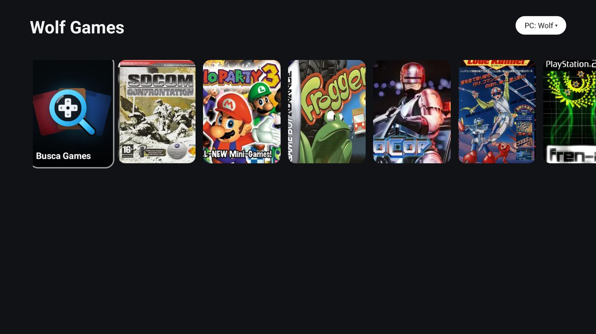

# Wolf Games

An add-on for the [CleanYourTV](https://github.com/Gathin23/cleanyourtv) launcher: it appears
there as a module card, and it can also open on its own from any Android TV / Google TV launcher.
It is listed in the CleanYourTV SHOWCASE.



A game shelf for the TV: the games you share from your PC through Moonlight appear as a row of
covers, OK launches a game, and with the optional Wolf session controller you can resume, close or
switch games without leaving the TV. Declares a module card ("Wolf Games", caption "Stream from
your PC") for the CleanYourTV launcher.

The visual: a 3D shelf of game boxes. The selected box faces you, the others fan out to the sides
showing their covers and spines, with a soft halo and a floor reflection. OK opens the box in place:
up opens the case, up again takes the disc out and spins it, left and right turn the box over,
X zooms, and OK inside the box plays. Spines, backs and disc labels are generated from the single
cover in the catalog.

The shelf's look (perspective, angles, timing and proportions) follows
[Boxshelf](https://github.com/sassiestrhihno/boxshelf-beta), GPL-3.0, used as a visual reference.
No Boxshelf code is included here.

## What it does

- Reads a `catalog.json` plus cover files that you push to the add-on's own external directory and
  shows them as one row of covers.
- OK on a game launches it through Moonlight (`com.limelight/.ShortcutTrampoline`, extras
  `Name`/`UUID`/`AppName`, plus `AppId` when the launch went through the session menu).
- With a provisioned Wolf session controller, OK first asks the Wolf what is running: resume the
  game, close it, or close it and open another one. Every close is confirmed and revision-checked;
  nothing is ever stopped implicitly.
- If the Wolf reports a running game, its cover gets a soft outline and a play badge.
- Moonlight not installed: a clear message on screen, no crash.

## Requirements

- [Moonlight](https://moonlight-stream.org) installed on the TV (the catalog and the launches belong
  to it). The [Wolf](https://github.com/games-on-whales/wolf) is optional.
- The catalog lives in the add-on's own external files directory: `moonlight/catalog.json` plus
  `*.png`/`*.jpg` covers. The `catalog.json` is a JSON object with `schema_version: 1`, `host_name`,
  `host_uuid` and `games` (a list of objects with `name` and optional `app_id` and `image`), plus an
  optional `hosts` list of objects with `name` and `uuid`. You push it with adb, or the add-on
  refreshes it from the Wolf when the session controller is provisioned (see Provisioning).

## Shown only with Moonlight

Without Moonlight the add-on hides itself: the launcher tile and the module card disappear. Once
Moonlight is installed, they come back at the next boot (or when the add-on is updated); to bring
them back right away:

```bash
adb shell pm enable io.github.vitorcamillo.wolfgames/.GamesActivity
```

## Provisioning

Open the add-on once first, so it creates its `moonlight` folder (a folder made by adb is not readable by the app). Then push the catalog and covers; repeat after every change and reopen the add-on:

```bash
adb connect <tv ip>
adb push catalog.json /sdcard/Android/data/io.github.vitorcamillo.wolfgames/files/moonlight/catalog.json
adb push 123.png /sdcard/Android/data/io.github.vitorcamillo.wolfgames/files/moonlight/123.png
```

Optional Wolf session controller: push `wolf-control.json` (version 1, an `https://` URL on LAN port
47991, the Wolf's `host_uuid`, the token, and the server certificate as base64 DER) to the add-on's
external directory:

```bash
adb push wolf-control.json /sdcard/Android/data/io.github.vitorcamillo.wolfgames/files/wolf-control.json
```

On the first open after the push the add-on validates the file, copies it into its private storage
and **deletes the external copy**, so the bearer token does not stay readable on shared storage. An
invalid file is discarded, not copied. Until you push a new one, the controller stays as it is; to
revoke it, uninstall the add-on (its private storage goes with it).

With the controller provisioned, the add-on also refreshes the catalog and covers from the Wolf
itself (same host, same port, same pinned certificate), so a push is only needed when the
controller is not provisioned.

## Security

The manifest asks for `INTERNET` and `RECEIVE_BOOT_COMPLETED`, and nothing else. The Wolf bearer
token never stays in shared storage: after provisioning, the add-on copies `wolf-control.json` into
its private storage and deletes the external copy. If you find a security problem, please report it
in the repository's issues.

## Permissions

- `INTERNET` — used only by the optional Wolf session controller: HTTPS to a single private IPv4
  address (10/8, 172.16/12 or 192.168/16), port 47991 only, with a pinned certificate and a bearer
  token, plus the catalog/cover refresh through the same connection. No other host is ever
  contacted. There is no telemetry, no ads, no analytics, no background service, no polling: the
  screen reads data when it opens or resumes, and nothing runs behind it.
- `RECEIVE_BOOT_COMPLETED` (start at boot) — a receiver that, on boot, only checks whether Moonlight
  is installed and shows or hides the tile and the card; it never opens the network and never keeps
  running.

The launcher itself needs no permission from this add-on: it talks to the launcher only through the
module card.

## Build and install

From the repository root (JDK 17, Android SDK 34). Build it yourself from a tag or commit you have
read: there are no prebuilt APKs (the release APK is signed with the debug key, for sideload).

```bash
./gradlew --no-daemon testReleaseUnitTest lintRelease assembleRelease
adb connect <tv ip>
adb install -r app/build/outputs/apk/release/app-release.apk
```

Press Home and answer Show when the launcher asks about the "Wolf Games" card.

## Tested on

TCL Smart TV Pro, Google TV 14.

License: MIT — see [LICENSE](LICENSE).
