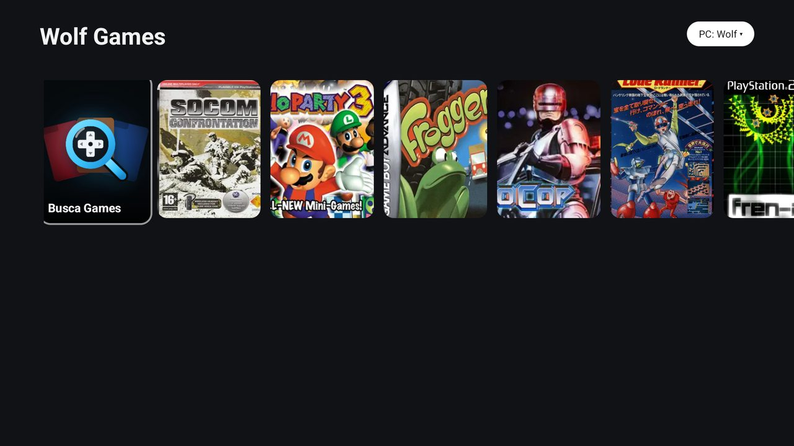

# Wolf Games

[English](README.md) · **Português**

  

Wolf Games é um complemento do inicializador [CleanYourTV](https://github.com/Gathin23/cleanyourtv) que mostra os jogos compartilhados do PC via Moonlight como uma fileira de capas na Android TV / Google TV. Ele é voltado a quem joga no PC via streaming e quer abrir, continuar, fechar ou trocar de jogo sem sair do sofá. Cada capa é renderizada como uma caixa de jogo em 3D, com lombadas, versos e rótulos de disco gerados a partir da única imagem de capa do catálogo.



*A prateleira de jogos: uma fileira de capas, OK abre o jogo selecionado.*

## Sumário

- [Recursos](#recursos)
- [Início rápido](#início-rápido)
- [Uso](#uso)
- [Configuração](#configuração)
- [Visível apenas com Moonlight](#visível-apenas-com-moonlight)
- [Provisionamento](#provisionamento)
- [Segurança](#segurança)
- [Permissões](#permissões)
- [Testado em](#testado-em)
- [Limitações e uso responsável](#limitações-e-uso-responsável)
- [Como funciona](#como-funciona)
- [Créditos](#créditos)
- [Licença](#licença)

## Recursos

- Abra jogos do sofá: OK sobre uma capa inicia o jogo através do Moonlight.
- Gerencie sessões sem sair da TV: com o controlador de sessão do Wolf opcional, continue um jogo em execução, feche-o ou feche-o e abra outro.
- Veja o que está em execução de relance: a capa do jogo em execução recebe um contorno suave e um selo de reprodução.
- Apareça onde você espera: um cartão de módulo ("Wolf Games", legenda "Stream from your PC") no inicializador CleanYourTV, listado no SHOWCASE dele, além de um atalho próprio em qualquer inicializador de Android TV / Google TV.
- Falhe de forma visível, nunca silenciosa: sem o Moonlight instalado, a tela mostra uma mensagem clara em vez de travar.
- Feche apenas com confirmação: todo encerramento é confirmado e verificado por revisão, e nada é encerrado de forma implícita.

## Início rápido

Requisitos:

- Um aparelho Android TV / Google TV (veja [Testado em](#testado-em)).
- [Moonlight](https://moonlight-stream.org) instalado na TV. O servidor [Wolf](https://github.com/games-on-whales/wolf) no PC é opcional.
- `adb` com acesso à rede da TV para a instalação e o primeiro envio do catálogo.
- Para compilar do código-fonte: JDK 17 e Android SDK 34.

Instale o APK da release e envie o primeiro catálogo:

```bash
adb connect <tv ip>
adb install -r wolf-games-0.2.0.apk
```

Baixe o arquivo `wolf-games-0.2.0.apk` na [release mais recente](https://github.com/vitorcamillo/wolf-games/releases/latest). O APK é assinado com a chave de depuração do Android, apenas para sideload; confira o SHA-256 com as notas da release.

Abra o complemento uma vez para que ele crie a pasta `moonlight` (uma pasta criada pelo adb não pode ser lida pelo aplicativo). Depois envie um `catalog.json` mínimo e reabra o complemento:

```bash
adb push catalog.json /sdcard/Android/data/io.github.vitorcamillo.wolfgames/files/moonlight/catalog.json
```

```json
{
  "schema_version": 1,
  "host_name": "My PC",
  "host_uuid": "12345678-1234-1234-1234-123456789abc",
  "games": [
    {
      "name": "My Game",
      "app_id": "123",
      "image": "123.png"
    }
  ]
}
```

Envie cada capa para junto do catálogo (`123.png` no exemplo) e repita o envio após cada alteração. Pressione Home e responda Show quando o inicializador perguntar sobre o cartão "Wolf Games".

Para compilar do código-fonte a partir da raiz do repositório, de uma tag ou commit que você tenha lido:

```bash
./gradlew --no-daemon testReleaseUnitTest lintRelease assembleRelease
adb connect <tv ip>
adb install -r app/build/outputs/apk/release/app-release.apk
```

## Uso

OK sobre um jogo o abre através do Moonlight (`com.limelight/.ShortcutTrampoline`, extras `Name`/`UUID`/`AppName`, além de `AppId` quando a abertura passou pelo menu de sessão). O Moonlight V+ (`com.limelight.qiin`) funciona da mesma forma e tem preferência quando ambos estão instalados.

Com o controlador de sessão do Wolf provisionado, OK primeiro pergunta ao Wolf o que está em execução e oferece continuar o jogo, fechá-lo ou fechá-lo e abrir outro. Todo fechamento é confirmado e verificado por revisão.

## Configuração

O catálogo fica no diretório externo próprio do complemento: `moonlight/catalog.json` mais as capas `*.png`/`*.jpg`. É um objeto JSON com os seguintes campos:

| Campo | Obrigatório | Descrição |
|---|---|---|
| `schema_version` | Sim | Precisa ser `1`. Qualquer outro valor rejeita o catálogo. |
| `host_name` | Sim | Nome de exibição do PC (por exemplo no seletor de host). |
| `host_uuid` | Sim | UUID do host do Moonlight ao qual o catálogo pertence. |
| `games` | Sim | Lista de jogos; cada um tem `name` obrigatório e `app_id` e `image` (nome do arquivo de capa) opcionais. |
| `hosts` | Não | Lista opcional de hosts extras, cada um com `name` e `uuid`. |

Você envia o catálogo com adb, ou o complemento o atualiza a partir do próprio Wolf quando o controlador de sessão está provisionado (veja [Provisionamento](#provisionamento)).

O controlador de sessão do Wolf opcional é configurado com o arquivo `wolf-control.json` (versão 1) no diretório externo do complemento:

| Campo | Obrigatório | Descrição |
|---|---|---|
| `version` | Sim | Precisa ser `1`. |
| `host_uuid` | Sim | UUID do host do Wolf, verificado em cada resposta. |
| `token` | Sim | Credencial bearer enviada ao controlador em cada requisição. |
| `server_certificate` | Sim | Certificado do servidor em DER base64; é fixado (pinned) e conferido em cada conexão. |
| `url` | Não | `https://<IPv4 privado>:47991` opcional, usado apenas quando a descoberta não encontra nada. |

Não há endereço a configurar: o PC anuncia o controlador na LAN via mDNS (`_wolf-control._tcp`, porta 47991, por exemplo com um arquivo de serviço Avahi) e o complemento o encontra seja qual for o IP do PC, de modo que o mesmo arquivo continua funcionando quando o IP muda ou em outro PC com o mesmo certificado e token.

## Visível apenas com Moonlight

Sem o Moonlight, o complemento se oculta: o atalho do inicializador e o cartão de módulo desaparecem. Com o Moonlight instalado, eles voltam na próxima inicialização (ou quando o complemento é atualizado); para trazê-los de volta de imediato:

```bash
adb shell pm enable io.github.vitorcamillo.wolfgames/.GamesActivity
```

## Provisionamento

Abra o complemento uma vez primeiro, para que ele crie a pasta `moonlight` (uma pasta criada pelo adb não pode ser lida pelo aplicativo). Depois envie o catálogo e as capas; repita após cada alteração e reabra o complemento:

```bash
adb connect <tv ip>
adb push catalog.json /sdcard/Android/data/io.github.vitorcamillo.wolfgames/files/moonlight/catalog.json
adb push 123.png /sdcard/Android/data/io.github.vitorcamillo.wolfgames/files/moonlight/123.png
```

Para provisionar o controlador de sessão do Wolf opcional, envie o `wolf-control.json` para o diretório externo do complemento:

```bash
adb push wolf-control.json /sdcard/Android/data/io.github.vitorcamillo.wolfgames/files/wolf-control.json
```

Na primeira abertura após o envio, o complemento valida o arquivo, copia-o para seu armazenamento privado e **apaga a cópia externa**, para que o bearer token não fique legível no armazenamento compartilhado. Um arquivo inválido é descartado, não copiado. Até você enviar um novo, o controlador permanece como está; para revogá-lo, desinstale o complemento (o armazenamento privado vai junto).

Com o controlador provisionado, o complemento também atualiza o catálogo e as capas a partir do próprio Wolf (mesmo host, mesma porta, mesmo certificado fixado), de modo que o envio só é necessário quando o controlador não está provisionado.

## Segurança

O manifesto pede `INTERNET` e `RECEIVE_BOOT_COMPLETED`, e nada mais. O bearer token do Wolf nunca permanece no armazenamento compartilhado: após o provisionamento, o complemento copia o `wolf-control.json` para seu armazenamento privado e apaga a cópia externa. Se você encontrar um problema de segurança, relate-o nas issues do repositório.

## Permissões

- `INTERNET` — usada apenas pelo controlador de sessão do Wolf opcional: descoberta mDNS de `_wolf-control._tcp` na LAN, depois HTTPS apenas para endereços IPv4 privados (10/8, 172.16/12 ou 192.168/16), apenas porta 47991, com certificado fixado (o endereço não é conferido contra ele, e sim o certificado e o `host_uuid` de cada resposta) e um bearer token, além da atualização de catálogo e capas pela mesma conexão. Nenhum outro host é contatado. Não há telemetria, anúncios, analytics, serviço em segundo plano nem sondagem: a tela lê os dados quando abre ou retoma, e nada executa por trás.
- `RECEIVE_BOOT_COMPLETED` (iniciar na inicialização) — um receptor que, na inicialização, apenas verifica se o Moonlight está instalado e mostra ou oculta o atalho e o cartão; nunca abre a rede e nunca continua em execução.

O inicializador em si não precisa de nenhuma permissão deste complemento: ele fala com o inicializador apenas através do cartão de módulo.

## Testado em

TCL Smart TV Pro, Google TV 14.

## Limitações e uso responsável

- O Moonlight é obrigatório: o catálogo e as aberturas pertencem a ele, e sem ele o complemento se oculta (veja [Visível apenas com Moonlight](#visível-apenas-com-moonlight)).
- O servidor Wolf é opcional e restrito à LAN: descoberta e HTTPS ficam em endereços IPv4 privados na porta 47991 com certificado fixado; não há caminho de acesso remoto.
- Apenas sideload: o APK é assinado com a chave de depuração do Android e não é publicado em nenhuma loja; verifique o SHA-256 com as notas da release antes de instalar.
- O controlador provisionado não pode ser editado no lugar: envie um novo arquivo para substituí-lo, ou desinstale o complemento para revogá-lo por completo.
- O projeto não coleta nada: sem telemetria, anúncios, analytics, serviço em segundo plano ou sondagem.
- O projeto não transmite jogos por conta própria e não substitui o Moonlight nem o servidor Wolf; respeite os termos das plataformas dos jogos e serviços que você transmite.

## Como funciona

A aparência da prateleira (perspectiva, ângulos, tempos e proporções) segue o [Boxshelf](https://github.com/sassiestrhihno/boxshelf-beta), GPL-3.0, usado como referência visual. Nenhum código do Boxshelf está incluído aqui. Veja [Créditos](#créditos).

O visual é uma prateleira 3D de caixas de jogo. A caixa selecionada fica de frente para você, as demais se abrem para os lados mostrando capas e lombadas, com um halo suave e reflexo no piso. OK abre a caixa no lugar: para cima abre o estojo, para cima de novo tira o disco e o gira, esquerda e direita viram a caixa, X aproxima, e OK dentro da caixa joga. Lombadas, versos e rótulos de disco são gerados a partir da única capa do catálogo.

## Créditos

O desenho visual da prateleira segue o [Boxshelf](https://github.com/sassiestrhihno/boxshelf-beta) (GPL-3.0) apenas como referência visual; nenhum código do Boxshelf está incluído neste projeto.

## Licença

MIT — veja [LICENSE](LICENSE).
